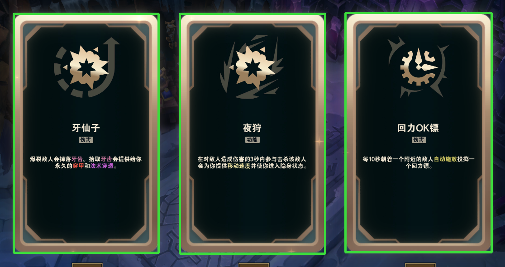

# aram-augment-advisor

《英雄联盟》海克斯大乱斗的符文选择助手：**截屏认出屏幕上的三个符文 → 查本地胜率库 → 直接告诉你选哪个。**

`Python` `OpenCV` `OCR` `Riot Live Client API` `MIT`



---

## 它做什么

打游戏时开着，一出现海克斯选择界面就自动识别并打印建议：

```
[21:32:41] 发现海克斯界面 -> shot_002.png
    卡片 #1 ✓  万用瞄准镜       (OCR 精确命中词表)
    卡片 #2 ✓  大力            (OCR 精确命中词表)
    卡片 #3 ✓  由暴生急         (OCR 精确命中词表)

[推荐] 疾风剑豪 · 3 级   （他本赛季平均胜率 57.5%）
  1. 大力          胜率 57.7%   比平均 +0.2%   （符文全局 51.1%）
  2. 由暴生急       胜率 51.6%   比平均 -5.9%   （符文全局 46.9%）
  3. 万用瞄准镜      胜率 50.9%   比平均 -6.6%   （符文全局 48.3%）
```

**注意第一行**：「大力」胜率 57.7% 看起来最高，但疾风剑豪本赛季的平均胜率就有 57.5% —— 这个符文对他几乎没用。而另外两个低于他平均 6 个百分点，是会拖后腿的。

只报胜率会误导人。**报"比这个英雄的平均高多少"才有意义。**

支持**刷新**：符文刷新后会自动重新识别、给出新的建议，而不是继续显示旧的。

---

## 怎么工作

### 识别链路：六道关

```
截图
 ├─ 1. 找卡片      轮廓检测，每帧现找，不依赖分辨率
 ├─ 2. 内容检查    卡面必须是深色底（挡掉英雄选择界面的彩色原画）
 ├─ 3. 对局门禁    本地数据接口连得上 = 在对局中（挡掉大厅、英雄选择）
 ├─ 4. 关键词挡板  卡面出现「锻造器」→ 属性锻造器界面，不是符文
 ├─ 5. OCR 定名    整张卡片喂 OCR，排除技能角标后取字号最大的行
 └─ 6. 置信度门槛  三张里至少两张命中词表，否则整帧丢弃
```

**六道关的取舍原则：宁可什么都不输出，也不要输出一个看起来很像答案的错误答案。**

这条原则是踩坑换来的。属性锻造器界面曾经顺利通过前三关，OCR 读出的三个猜测全被自己标了「低置信度」，但程序还是把三个错误答案连同胜率表一起打印了出来 —— 我看到的是三个真实符文名加一份推荐，**完全不像出错的样子**。

### 数据链路

```
aramkit.com ──爬虫──> raw/*.json ──建库──> SQLite ──查询──> 建议
                                            ↑
Riot 本地接口 ──── 英雄名 + 等级 ────────────┘
```

- **符文胜率**来自 [aramkit.com](https://aramkit.com)（静态 JSON，无需解析 HTML）
- **英雄和等级**来自 Riot 官方本地数据接口 `127.0.0.1:2999`，不做头像识别
- **不自动点击、不注入游戏进程**，只读屏幕

---

## 安装

需要 **Windows**（用到 `pywin32` 读窗口位置）和 **Python 3.10+**。

```bash
pip install -r requirements.txt
```

## 使用

### 第一次：准备数据

```bash
python crawler.py          # 抓符文/英雄胜率，约 5 分钟，99 MB
python download_icons.py   # 抓 216 个符文图标，约 2 分钟
python build_db.py         # 整理成 SQLite
```

### 之后：开用

```bash
python watch.py
```

打游戏时开着它。出现海克斯选择界面就会自动识别并打印建议。

---

## 项目结构

```
watch.py              主循环：截图 → 识别 → 查库 → 打印建议（成品就是它）
recognize.py          识别：找卡片 + OCR + 词表匹配
advise.py             推荐：查库、排序、组文案
liveapi.py            Riot 官方本地接口，拿英雄名和等级

crawler.py            爬虫：aramkit → raw/*.json
build_db.py           建库：raw/*.json → SQLite
download_icons.py     下载符文图标

capture.py            手动截一张游戏画面（调试用）
calibrate.py          标定卡片位置（换分辨率时用）

dev/                  探索过程的中间脚本，不参与运行
```

---

## 数据来源与合规

**数据来源**：[aramkit.com](https://aramkit.com)（robots.txt 允许抓取）。仅供个人学习，**请勿重新分发数据**。仓库里不含任何抓取结果。

**合规边界**：

- ✅ 只读屏幕，不注入游戏进程，不模拟点击
- ✅ 英雄信息走 Riot 官方提供的本地接口
- ⚠️ 实时给出建议处于 Riot 第三方软件政策的灰色地带。**请自行判断风险**
- ❌ 不要改造成自动选择符文 —— 那属于自动化，明确违规

游戏截图和召唤师 ID 都不在仓库里（见 `.gitignore`）。

---

## 已知不足

- **图标匹配目前不参与判定**，只作为报告信息。它的准确率依赖卡片框精度，而卡片框由轮廓检测得出，有时会多框一截。OCR 表现更稳。
- **`detect_cards` 用亮度阈值**，遇到明亮背景（比如粉红森林那张地图）会框歪。目前不影响结果（OCR 不依赖框的精度），但有残留风险。
- **测试集只有 31 张截图 / 93 张卡片**，全部人工核对过。棱彩稀有度的卡片验证较少。
- **只有中文客户端**验证过。

---

## 踩过的坑

这个项目最有价值的部分大概是下面这些 —— 没有一个是预先设计出来的，全是跑起来才暴露的。

**① 坐标写死 = 绑定分辨率。**
一开始把三张卡片的位置写成 1920×1080 下的绝对像素。后来我的游戏窗口变成 2000×1125，坐标全部失效。改成每帧用轮廓检测现找。

**② 窗口最小化时会拿到 `0x0 @ (-32000,-32000)`。**
Windows 给最小化窗口的固定坐标。直接拿去截图会抛异常。

**③ 假阳性比报错危险得多。**
英雄选择界面中间也有三张并排的卡片，几何特征一模一样。程序识别出三个"符文"，打了三个绿勾，而那时候屏幕上根本没有海克斯。

**④ 一次错误可以六步全静默。**
明亮背景 → 亮度阈值把背景框进来 → 闭运算把卡片和按钮连成一块 → 框高从 528 变 603 → 名称区下移到类别标签上 → OCR 只读到「伤害」→ 和词表里所有名字相似度都是 0.000 → 并列时按字典序随便挑了一个。**输出了一个带绿勾的错误答案。**

**⑤ 「低置信度」也要拒绝，不能只给警告。**
猜测错了就说"我不知道"，不能说"我觉得是 X（但可能不对）"。

**⑥ 收益率要减英雄自己的基线，不是符文的全局胜率。**
减错的后果：皮城执法官自身胜率只有 46.7%，他和任何符文的组合都低于符文全局平均，于是"三个收益全是负数"天天误报。

**⑦ 用时间做冷却，会挡掉刷新。**
「20 秒内不重复输出」在符文刷新后会把新选项挡在门外 —— 而刷新恰恰是最需要看建议的时刻。改成按「选项组合变了没有」判断。

**⑧ 形态明确的东西，别用模糊阈值去猜。**
技能角标 `[Q]` 和符文名的字号完全一样。「差 10% 以内算并列」这种模糊规则会把类别标签也放进来。按形态排除（括号里一个 QWER 字母）才对。

---

## License

[MIT](LICENSE)
